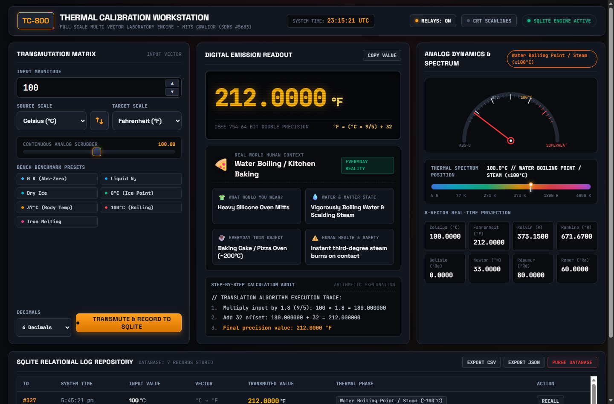

# Quantum Thermal HUD • Temperature Conversion System

A modern, high-precision scientific temperature conversion and thermal telemetry application built for students, researchers, and engineers. Engineered with a full-stack 3-tier architecture—combining a futuristic **Cyber-HUD** front-end, a modular **Express.js REST API**, and a high-performance **SQLite 3** relational database with Write-Ahead Logging (WAL mode).

---

## ✨ System Features

- **8-Scale Scientific Engine:** Accurate transformations across all primary thermodynamic and historical scales:
  - **Celsius (°C)**, **Fahrenheit (°F)**, **Kelvin (K)**
  - **Rankine (°R)**, **Delisle (°De)**, **Newton (°N)**
  - **Réaumur (°Ré)**, **Rømer (°Rø)**
- **Thermodynamic Limit Enforcement:** Enforces Absolute Zero lower boundaries ($-273.15^\circ\text{C}$, $-459.67^\circ\text{F}$, $0\text{ K}$, $0^\circ\text{R}$) with physical validation checks.
- **Kinetic Molecular Reactor (Canvas 2D):** A real-time molecular Brownian motion simulation that physically reacts to temperature: particles freeze into crystalline lattices at cryogenic temperatures and accelerate into high-energy plasma states at elevated temperatures.
- **Holographic Radial Gauge:** Dynamic SVG dial displaying thermodynamic excitation levels and classified environmental thermal tiers (Absolute Zero, Cryogenic, Ambient, Biological, Boiling, Magma, Plasma).
- **8-Scale Simultaneous Telemetry Radar:** Projects entered temperatures across all 8 scales simultaneously for side-by-side scientific comparison.
- **Synthesized Sci-Fi Audio FX:** Generates holographic laser chirps, quantum swap chimes, and alert klaxons synthesized in real time via the **Web Audio API** (zero external audio files).
- **Embedded SQLite 3 Database:** Logs conversions with temporal indexing, providing analytical telemetry, historical review, and one-click **CSV/JSON export**.
- **Retro CRT Scanline Mode:** Optional retro-futuristic CRT filter for an authentic command-center dashboard experience.

---

## 🏗️ Full-Stack 3-Tier Architecture

The system implements a decoupled client-server-database architecture:

```
┌────────────────────────────────────────────────────────┐
│      PRESENTATION TIER: Futuristic Cyber-HUD UI        │
│  HTML5 • CSS3 Glassmorphism • Canvas 2D • Web Audio    │
└───────────────────────────┬────────────────────────────┘
                            │ HTTP / JSON REST API
┌───────────────────────────▼────────────────────────────┐
│      APPLICATION SERVER TIER: Express.js REST API      │
│  ConversionService (8 Scales) • ValidationService      │
└───────────────────────────┬────────────────────────────┘
                            │ Native Synchronous SQL & WAL
┌───────────────────────────▼────────────────────────────┐
│         PERSISTENCE TIER: Embedded SQLite 3 DB         │
│  Indexed 'conversions' Table • Temporal Analytics      │
└────────────────────────────────────────────────────────┘
```

### Full-Stack Architecture


### Database Schema (SQLite 3)


### Live Cyber-HUD Command Deck


---

## 📁 Repository Structure

```
temperature-conversion-system/
├── client/                           # Futuristic Cyber-HUD Frontend
│   ├── index.html                    # Quantum Command Deck Layout
│   ├── css/
│   │   └── hud.css                   # Glassmorphism & Cyberpunk Neon Styling
│   └── js/
│       ├── audio.js                  # Web Audio API Synthesizer
│       ├── particles.js              # Kinetic Molecular Brownian Simulation
│       ├── gauge.js                  # Holographic Radial SVG Gauge
│       ├── api.js                    # REST API Client with Offline Fallback
│       └── app.js                    # Master UI Controller
├── server/                           # Express.js REST Backend
│   ├── config/
│   │   └── db.js                     # SQLite 3 Database & WAL Setup
│   ├── services/
│   │   ├── conversionService.js      # 8-Scale Scientific Engine
│   │   ├── validationService.js      # Thermodynamic Limits Checker
│   │   └── historyService.js         # Persistence & Export Logic
│   ├── routes/
│   │   └── api.js                    # REST Endpoints
│   └── server.js                     # Server Entry Point
├── diagrams/                         # Architectural & UML Diagrams
├── tests/
│   └── backend.test.js               # Automated Verification Suite (43 Tests)
├── package.json                      # Node.js Dependencies & Scripts
└── README.md                         # Project Documentation
```

---

## 🚀 Quickstart Guide

### Prerequisites
- **Node.js** (v18.0 or newer recommended, v26.8+ tested)
- **npm** (included with Node.js)

### 1. Installation
Clone the repository and install dependencies:
```bash
git clone https://github.com/B1tBr34k3r/temperature-conversion-system.git
cd temperature-conversion-system
npm install
```

### 2. Launch the System
Start the integrated server:
```bash
npm start
```
Open your browser and navigate to:
```
http://localhost:3000
```

### 3. Run Automated Tests
Execute the automated test suite covering all 8 scales, thermodynamic bounds, and SQLite transactions:
```bash
npm test
```

---

## 🧪 Automated Verification Suite

The system includes 43 automated unit and integration assertions:
- **8-Scale Accuracy:** Freezing, boiling, and convergence benchmarks validated within $\le 10^{-4}$ tolerance.
- **Thermodynamic Limits:** Absolute Zero lower boundaries verified across all scales.
- **Syntactic Validation:** Rejection of empty strings, non-numeric tokens, and infinity values.
- **Database Transactions:** Insertions, chronological queries, analytics, and VACUUM verified with zero data corruption.

---

## 👥 Authors & Credits

- **Prakhar Harne**
- **Naman Shrivastav**
