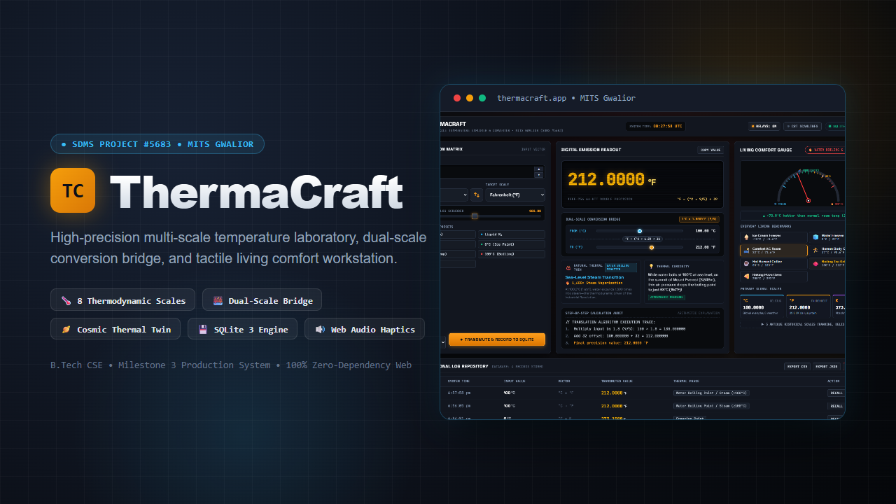
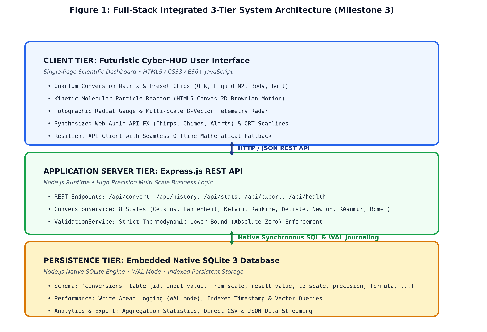
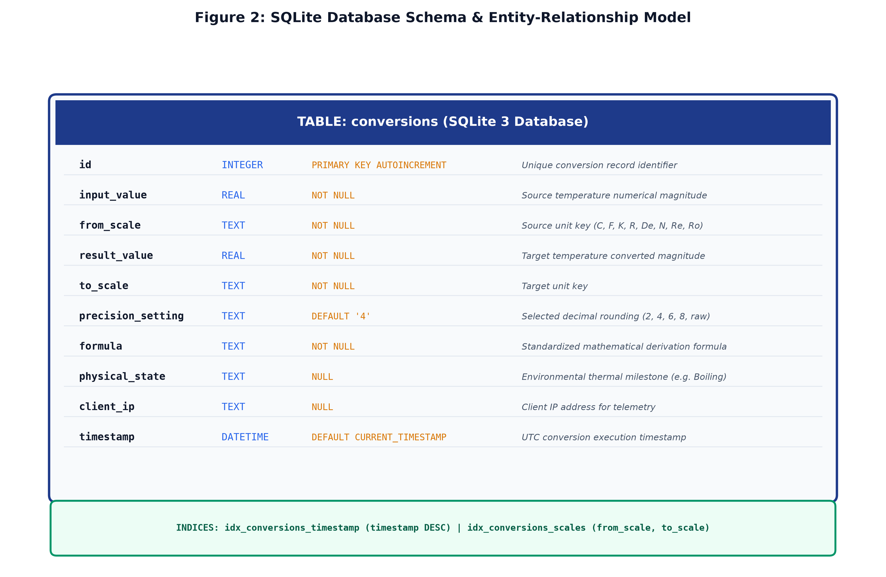
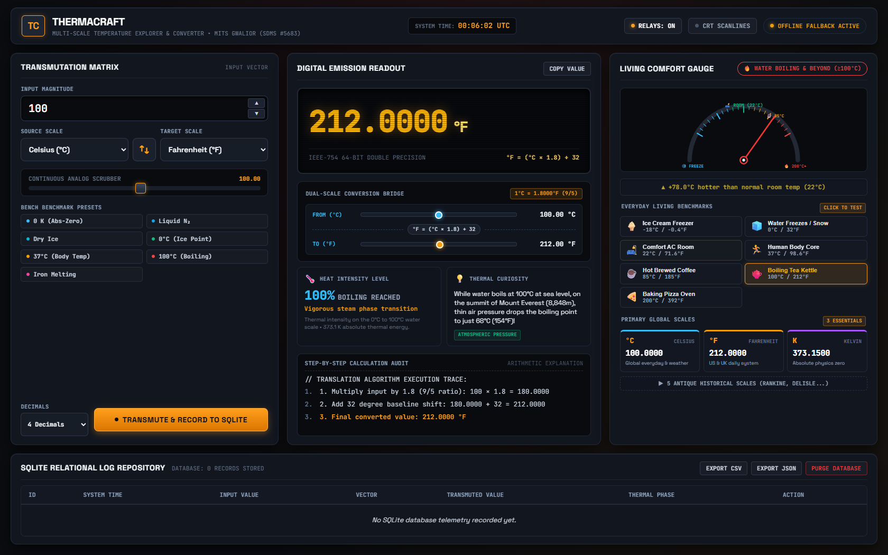

# ThermaCraft • Temperature Conversion System



A high-precision, tactile scientific temperature conversion workstation designed for students, educators, and curious minds. Built with an approachable **analog-digital instrument aesthetic**—combining a physical bench-studio interface, an **Express.js REST API**, an embedded **SQLite 3** relational database engine operating with Write-Ahead Logging (WAL mode), and a **100% standalone zero-dependency mode for GitHub Pages**.

🔗 **Live Public Web Application:** [https://b1tbr34k3r.github.io/temperature-conversion-system/](https://b1tbr34k3r.github.io/temperature-conversion-system/)

---

## ✨ Studio Features & Human-Centric Design

- **Dual-Scale Conversion Bridge & Practical Living Advisor (Zero Redundancy):**
  - **Dual-Scale Alignment Ruler:** A synchronized side-by-side visual ruler that graphically maps input magnitude to the target scale with live animated pips, exact scale ratio multipliers (e.g. $1^\circ\text{C} = 1.8000^\circ\text{F}$), and baseline shift chips ($+32^\circ\text{F}$).
  - **Practical Living & Everyday Comfort Advisor:** Translates any temperature into actionable, real-world human advice that anyone can understand—what it actually feels like (from frosty puddles to piping coffee and hot baking ovens), recommended clothing or safety gear (jackets, sunglasses, silicone oven mitts), and useful everyday household/culinary tips.
  - **Dynamic Thermal Curiosity Flashcards:** Temperature-triggered scientific and historical gems: from why water boils at just $68^\circ\text{C}$ on Mount Everest, to Anders Celsius's original inverted 1742 scale, to the Maillard reaction that browns baked goods.

- **Living Comfort & Everyday Relatability:**
  - **Living Comfort Gauge:** Damped spring-physics analog needle dynamically sweeps across intuitive everyday comfort zones: Freezing ($< 0^\circ\text{C}$), Living Comfort ($15\text{--}26^\circ\text{C}$), Summer Heat ($27\text{--}50^\circ\text{C}$), and Scalding/Boiling ($> 50^\circ\text{C}$).
  - **Room Temperature Delta Callout:** Real-time delta readout displaying exact temperature offset relative to typical room comfort ($22^\circ\text{C} / 72^\circ\text{F}$).
  - **7 Everyday Living Benchmarks:** Instant single-click test presets for relatable real-world objects: Ice Cream Freezer ($-18^\circ\text{C}$), Snow/Water Freezing ($0^\circ\text{C}$), AC Living Room ($22^\circ\text{C}$), Human Core ($37^\circ\text{C}$), Hot Coffee ($85^\circ\text{C}$), Boiling Kettle ($100^\circ\text{C}$), and Baking Pizza ($200^\circ\text{C}$).
  - **Primary Essentials + Antique Scales Drawer:** Clear, prominent cards for the Big Three global scales (Celsius, Fahrenheit, Kelvin), with an expandable drawer exploring 5 historical antique scales (Rankine, Delisle, Newton, Réaumur, Rømer) with concise historical origin notes.

- **Artisanal Tactile Console Experience:**
  - **Synthesized Mechanical Sound Design:** Tactile relay clicks, rotary switch clunks, and analog coil whines synthesized via the **Web Audio API** (zero external MP3/WAV assets).
  - **Luminescent Digital Screen:** Warm amber phosphor digits with scientific 64-bit IEEE-754 double precision telemetry.
  - **Embedded SQLite 3 & In-Browser Fallback:** Works full-stack via Express REST API or 100% client-side on GitHub Pages with local storage history and in-browser CSV/JSON downloads.

- **8-Scale Scientific Engine:** Accurate transformations across all primary thermodynamic and historical scales:
  - **Celsius (°C)**, **Fahrenheit (°F)**, **Kelvin (K)**
  - **Rankine (°R)**, **Delisle (°De)**, **Newton (°N)**
  - **Réaumur (°Ré)**, **Rømer (°Rø)**
- **Thermodynamic Limit Enforcement:** Enforces Absolute Zero lower boundaries ($-273.15^\circ\text{C}$, $-459.67^\circ\text{F}$, $0\text{ K}$, $0^\circ\text{R}$) with rigorous validation checks.
- **Embedded SQLite 3 Database:** Logs conversions with temporal indexing, providing analytical telemetry, historical review, and one-click **CSV/JSON export**.

---

## 🏗️ Full-Stack 3-Tier Architecture

```
┌────────────────────────────────────────────────────────┐
│     PRESENTATION TIER: ThermaCraft Studio Console      │
│  Dual-Scale Bridge • Living Comfort Gauge • Web Audio  │
└───────────────────────────┬────────────────────────────┘
                            │ HTTP / JSON REST API
┌───────────────────────────▼────────────────────────────┐
│      APPLICATION SERVER TIER: Express.js REST API      │
│  ConversionService (8 Scales) • ValidationService      │
└───────────────────────────┬────────────────────────────┘
                            │ Native Synchronous SQL & WAL
┌───────────────────────────▼────────────────────────────┐
│         PERSISTENCE TIER: Embedded SQLite 3 DB         │
│  Indexed 'conversions' Table • Temporal Analytics      │
└────────────────────────────────────────────────────────┘
```

### Full-Stack Architecture


### Database Schema (SQLite 3)


### Live ThermaCraft Studio Console


---

## 📁 Repository Structure

```
temperature-conversion-system/
├── client/                           # Tactile Laboratory Instrument Frontend
│   ├── index.html                    # TC-800 Hardware Console Layout
│   ├── css/
│   │   └── hud.css                   # Artisanal Milled Metal & Phosphor Styling
│   └── js/
│       ├── audio.js                  # Mechanical Relay & Analog Synthesizer
│       ├── gauge.js                  # Damped Spring-Physics Comfort Tachometer
│       ├── thermalContext.js         # Heat Intensity Engine & Thermal Curiosity
│       ├── api.js                    # REST API Client with Offline Fallback
│       └── app.js                    # Master Console Controller
├── server/                           # Express.js REST Backend
│   ├── config/
│   │   └── db.js                     # SQLite 3 Database & WAL Setup
│   ├── services/
│   │   ├── conversionService.js      # 8-Scale Scientific Engine
│   │   ├── validationService.js      # Thermodynamic Limits Checker
│   │   └── historyService.js         # Persistence & Export Logic
│   ├── routes/
│   │   └── api.js                    # REST Endpoints
│   └── server.js                     # Server Entry Point
├── diagrams/                         # Architectural & UML Diagrams
├── tests/
│   └── backend.test.js               # Automated Verification Suite (43 Tests)
├── package.json                      # Node.js Dependencies & Scripts
└── README.md                         # Project Documentation
```

---

## 🚀 Quickstart Guide

### Prerequisites
- **Node.js** (v18.0 or newer recommended, v26.8+ tested)
- **npm** (included with Node.js)

### 1. Installation
Clone the repository and install dependencies:
```bash
git clone https://github.com/B1tBr34k3r/temperature-conversion-system.git
cd temperature-conversion-system
npm install
```

### 2. Launch the Instrument Console
Start the integrated server:
```bash
npm start
```
Open your browser and navigate to:
```
http://localhost:3000
```

### 3. Run Automated Tests
Execute the automated test suite covering all 8 scales, thermodynamic bounds, and SQLite transactions:
```bash
npm test
```

---

## 👥 Authors & Credits

- **Prakhar Harne**
- **Naman Shrivastav**
